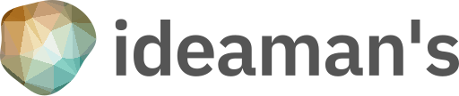
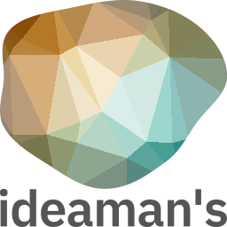
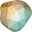

# アイデアマンズ ロゴマーク自動生成 v2

[アイデアマンズ株式会社](https://www.ideamans.com/)のロゴマークを自動生成するWebアプリケーションです。

ロゴマークは、`seed`パラメータとして渡した値に応じてランダムに変化します。

### seedの変数

`seed`には`{変数名}`の形で変数を埋め込めます。

| 変数 | 展開される値 |
| --- | --- |
| `{today}` | `tz`のタイムゾーンでの今日の日付（`YYYYMMDD`） |

- 例: `/v2/icon.png?seed={today}` → `seed=20261104`と同じ
- 例: `/v2/icon.png?seed=logo-{today}&tz=America/New_York` → ニューヨーク時間の日付になる
- `tz`はIANAタイムゾーン名です。省略時は環境変数`TZ`、未設定なら`Asia/Tokyo`です。不正な値は`400`を返します
- 未知の変数（`{foo}`など）は展開せず、そのまま文字列として扱います
- 環境変数`DEFAULT_SEED`にも変数を使えます
- SVGの`title`要素とPNGの`Seed`チャンクには展開後の値が入ります

アイデアマンズ株式会社は、プログラミング技術による価値の創造を最大の強みとする企業です。そのコーポレートアイデンティティを表現するには、ロゴマークがプログラミングで作られるべきという考えに至りました。

## ロゴマークのタイプ

### インラインタイプ

マークの横に社名が表示される横長タイプです。



- エントリーポイント
  - `/v2/inline.svg` または `/v2/inline.png`
- パラメータ
  - `seed` マークのパターンを決めるランダムシード文字列です。デフォルト値は`alogorithm2`です。変数（`{today}`）を使えます。
  - `tz` `seed`の変数を展開するタイムゾーンです。デフォルト値は`Asia/Tokyo`です。
  - `width` マークの幅です。デフォルト値は`512`です。高さは社名の長さに応じて決まります。
  - `colorTheme` 適応させるカラーテーマです。`light`または`dark`を指定できます。デフォルトは`light`です。

### 矩形タイプ

マークの下に社名が表示される矩形タイプです。正方形やOGP画像に利用します。



- エントリーポイント
  - `/v2/rect.svg` または `/v2/rect.png`
- パラメータ
  - `seed` マークのパターンを決めるランダムシード文字列です。デフォルト値は`alogorithm2`です。変数（`{today}`）を使えます。
  - `tz` `seed`の変数を展開するタイムゾーンです。デフォルト値は`Asia/Tokyo`です。
  - `width` マークの幅です。デフォルト値は`512`です。
  - `height` マークの高さです。デフォルト値は`width`を参照します。
  - `colorTheme` 適応させるカラーテーマです。`light`または`dark`を指定できます。デフォルトは`light`です。

### アイコンタイプ

マークだけが表示されるタイプです。主にFaviconに使用します。以下のパラメータを指定できます。



- エントリーポイント
  - `/v2/icon.svg` または `/v2/icon.png`
- パラメータ
  - `seed` マークのパターンを決めるランダムシード文字列です。デフォルト値は`alogorithm2`です。変数（`{today}`）を使えます。
  - `tz` `seed`の変数を展開するタイムゾーンです。デフォルト値は`Asia/Tokyo`です。
  - `width` マークの幅です。デフォルト値は`64`です。
  - `height` マークの高さです。デフォルト値は`width`を参照します。
  - `circle` `1`を指定すると、マークを円で切り抜きます。
  - `square` `1`を指定すると、マークを正方形で切り抜きます。`circle`と同時に指定した場合は`circle`が優先されます。
  - `radius` `square`の角丸の半径です。短辺に対する比率で`0`〜`0.5`を指定します。デフォルト値は`0`（角丸なし）で、`0.5`で円と同じ形になります。

`circle`と`square`は、`width`と`height`が異なる場合、短辺を直径（一辺）として中央に配置します。

## パターン生成

[trianglify](https://www.npmjs.com/package/trianglify)で幾何学パターンを生成し、[blobs](https://www.npmjs.com/package/blobs)でそれをクリッピングしています。

## 開発・テスト

```bash
yarn install
yarn test            # build + eslint + prettier + cspell + ava（ユニット / HTTP / ゴールデン比較）
yarn start           # http://localhost:3001/v2/icon.svg
yarn docker:smoke    # 本番と同じ Docker イメージをビルドし、コンテナ内でテスト実行 + 全エンドポイントへHTTPで疎通確認
```

- テストは `src/spec/*.spec.ts` にあり、ビルド後の `build/spec/*.spec.js` を ava が実行します（cwd はリポジトリルート）。
- `fixtures/golden/` に代表的な入力に対する出力を保存しています。
  - SVG はバイト一致で比較します（生成は純JSなので、差分が出たらロゴが変わったことを意味します）。
  - PNG は sharp（libvips / librsvg）のバージョン差を吸収するため、ピクセル単位で許容誤差付きで比較します。
- 意図してロゴの出力を変えた場合は `yarn golden:update` でゴールデンファイルを再生成し、差分を確認してからコミットしてください。
