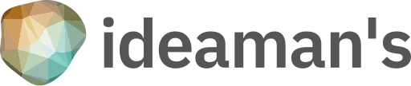
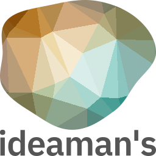
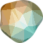

# アイデアマンズ ロゴマーク自動生成 v2

[アイデアマンズ株式会社](https://www.ideamans.com/)のロゴマークを自動生成するWebアプリケーションです。

ロゴマークは、`seed`パラメータとして渡した値に応じてランダムに変化します。

アイデアマンズ株式会社は、プログラミング技術による価値の創造を最大の強みとする企業です。そのコーポレートアイデンティティを表現するには、ロゴマークがプログラミングで作られるべきという考えに至りました。

## ロゴマークのタイプ

### インラインタイプ

マークの横に社名が表示される横長タイプです。



- エントリーポイント
  - `/v2/inline.svg` または `/v2/inline.png`
- パラメータ
  - `seed` マークのパターンを決めるランダムシード文字列です。デフォルト値は`alogorithm2`です。
  - `width` マークの幅です。デフォルト値は`512`です。高さは社名の長さに応じて決まります。
  - `colorTheme` 適応させるカラーテーマです。`light`または`dark`を指定できます。デフォルトは`light`です。

### 矩形タイプ

マークの下に社名が表示される矩形タイプです。正方形やOGP画像に利用します。



- エントリーポイント
  - `/v2/rect.svg` または `/v2/rect.png`
- パラメータ
  - `seed` マークのパターンを決めるランダムシード文字列です。デフォルト値は`alogorithm2`です。
  - `width` マークの幅です。デフォルト値は`512`です。
  - `height` マークの高さです。デフォルト値は`width`を参照します。
  - `colorTheme` 適応させるカラーテーマです。`light`または`dark`を指定できます。デフォルトは`light`です。

### アイコンタイプ

マークだけが表示されるタイプです。主にFaviconに使用します。以下のパラメータを指定できます。



- エントリーポイント
  - `/v2/icon.svg` または `/v2/icon.png`
- パラメータ
  - `seed` マークのパターンを決めるランダムシード文字列です。デフォルト値は`alogorithm2`です。
  - `width` マークの幅です。デフォルト値は`64`です。
  - `height` マークの高さです。デフォルト値は`width`を参照します。

## パターン生成

[trianglify](https://www.npmjs.com/package/trianglify)で幾何学パターンを生成し、[blobs](https://www.npmjs.com/package/blobs)でそれをクリッピングしています。

## 開発・テスト

```bash
yarn install
yarn test            # build + eslint + prettier + cspell + ava（ユニット / HTTP / ゴールデン比較）
yarn start           # http://localhost:3001/v2/icon.svg
yarn docker:smoke    # 本番と同じ Docker イメージをビルドし、コンテナ内でテスト実行 + 全エンドポイントへHTTPで疎通確認
```

- テストは `src/spec/*.spec.ts` にあり、ビルド後の `build/spec/*.spec.js` を ava が実行します（cwd はリポジトリルート）。
- `fixtures/golden/` に代表的な入力に対する出力を保存しています。
  - SVG はバイト一致で比較します（生成は純JSなので、差分が出たらロゴが変わったことを意味します）。
  - PNG は sharp（libvips / librsvg）のバージョン差を吸収するため、ピクセル単位で許容誤差付きで比較します。
- 意図してロゴの出力を変えた場合は `yarn golden:update` でゴールデンファイルを再生成し、差分を確認してからコミットしてください。
